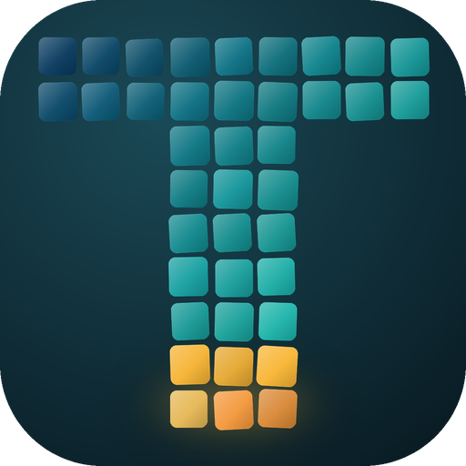
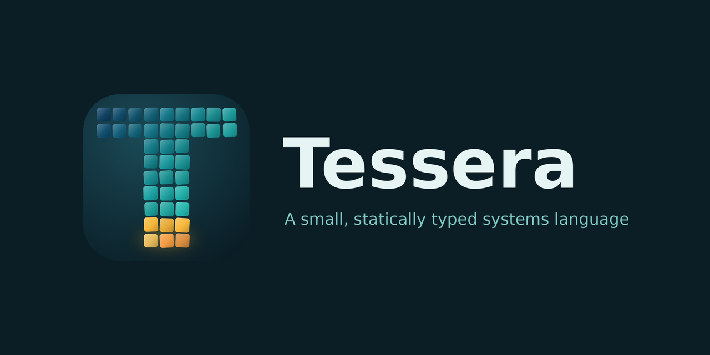

<p align="center">
  
</p>

# Tessera

*A small systems language, its own compiler, and a chess engine written in it — built to see how far a from-scratch stack can get against Stockfish on a cheap, single-threaded box.*

<p align="center">
  
</p>

This is two things in one repo:

1. **Tessera** — a small, statically typed, ahead-of-time-compiled systems language with a compiler
   written in Rust (`tesserac`). Value types, flat memory, no GC, no hidden allocations, and
   first-class primitives for the kind of bit-twiddling chess code lives on (u64 bitboards,
   `popcount`/`ctz`/`clz`, `pext`/`pdep`, `btable_index`, `[T; N]` arrays, `const` tables,
   compile-time data).
2. **A UCI chess engine written entirely in Tessera** — bitboards, magic movegen, a transposition
   table, alpha-beta + quiescence + iterative deepening, and a hand-crafted eval.

The goal is deliberately ambitious: **match or beat Stockfish in both strength and speed on
low-end hardware** — one thread, a small hash, no AVX2, on old x86 laptops and Pi-class ARM. That
goal is a *stretch*, and this README won't pretend otherwise.

## Why this exists

Two reasons, honestly:

- **A proving ground for the language.** Chess engines are a brutal test: they punish hidden
  allocations, clumsy codegen, and slow memory layouts immediately. If Tessera can make a
  competitive engine, it can make anything.
- **A real target to measure against.** "Fast" and "strong" mean nothing without numbers, so the
  engine doubles as the benchmark the compiler is judged by — nodes/sec per CPU tier, and Elo via
  SPRT against a tier-matched Stockfish.

If you're here for a novel systems language to poke at, or you like watching someone try to
out-run Stockfish on a 2013 laptop from the metal up, you're in the right place.

## Status: very early, and honest about it

This is **research-grade / pre-alpha**. Lots works; lots doesn't; and the thing that would make it
"good" (a trained evaluation) is exactly what a from-scratch project on one old machine can't
just conjure up. Concretely:

**What works (and is measured, not claimed):**
- The compiler pipeline: lexer → parser → type checker → **C backend → clang → native binary**
  (99 compiler tests pass). It compiles and runs real programs.
- Bitboard move generation that is **exact on standard perft positions** (startpos, Kiwipete,
  position 3) across **three build tiers** (SSE2 / SSE4.2+POPCNT / AVX2+BMI2).
- A searching UCI engine: on this laptop it sustains **~0.8M nodes/sec (bench 6, AVX2 tier)**,
  roughly **7× faster than its own first (mailbox) version**, and raw-faster than the tier-matched
  Stockfish's own bench (~469k nps) — though Stockfish does far more work per node, so that number
  isn't a strength claim.
- Language surface: `u64` bitboards, `i8`/`i16`/`u16` arrays, `f32`/`f64` floats, bit intrinsics,
  text and binary file I/O (`fopen`/`fread_i16`/`fread_i32`/`feof`/`fclose`, `substr`, `len`,
  `concat`), `popcount`/`ctz`/`now_ms`/`btable_index` builtins, `as` casts, type aliases, and
  `import "path";` multi-file composition.
- A complete, self-hosted NNUE loop: the engine loads a fixed-point weight file and keeps
  white/black-view accumulators incrementally inside `make()`; `tools/gen_data.py` turns self-play
  PGNs into training records and `tools/train.py` trains a 768→32→1 net with hand-derived backprop.
  The engine and the trainer agree on the score in **9/9** probe positions. The net trained on 37k
  positions is **not** competitive yet — see
  [docs/milestones/M13-nnue-training.md](docs/milestones/M13-nnue-training.md).
- Search features: iterative deepening, alpha-beta, quiescence, transposition table, null-move
  pruning, late-move reductions, killers/history move ordering, check extensions, repetition
  detection, and a tapered evaluation (piece-square tables + pawn structure + mobility + king
  safety). `go depth 10` from the start position finishes in ~0.7 s.

**What doesn't (yet), stated plainly:**
- **It is much weaker than full Stockfish.** In a fair match (both 1 thread, 16 MB hash, 5+0.05) it
  lost **0–16** to Stockfish 19 at full strength, but beat the *same* Stockfish restricted to
  `Skill Level 0` **13–6–1 (67.5%)** at identical limits. The bottleneck is no longer the protocol or
  movegen — it's the **evaluator**: hand-crafted terms, and a neural net that is still in the
  "does it run and does it learn" stage (37k training positions, 0–7–1 against the hand-crafted
  eval). Stockfish's net is trained on millions of positions.
- No LLVM backend yet (the backend is C → clang), no opening book, no endgame tablebases, and a
  number of rough edges in the language.
- The engine source is split into modules (`engine/modules/{types,movegen,eval,nnue,search,uci}.ter`)
  stitched together with `import`, but `engine/bb.ter` is still the single entry point.
- The earlier "0–8, all by mate" result turned out to be a **compiler bug**, not a weak eval:
  every binary operator was being parsed as right-associative, so `0 - beta + 1` meant
  `0 - (beta + 1)`. See [docs/milestones/M9-precedence-fix.md](docs/milestones/M9-precedence-fix.md).

So: the *engine* is fast and correct; the *strength* is early. Don't expect it to win a game
against Stockfish today.

## How to read the numbers here

Every speed/Elo number in `docs/` was measured on a specific box (an Intel i3-4130, single thread)
and comes with the caveats that let you reproduce or dispute it. Where we compared against
Stockfish we used the build that matches this CPU's features, at identical thread/hash/time limits
— a fair match is the only useful one. Nothing here is a marketing number.

## Build & try it

You'll need a Rust toolchain and clang.

```bash
cd compiler
cargo build
# A quick speed run (perft + a small search), AVX2 tier:
target/debug/tesserac.exe build samples/bbuci.ter -o /tmp/tessera --tier c

# Or the compiler itself, on a Tessera program:
target/debug/tesserac.exe run samples/fib.ter
```

`engine/bb.ter` is the engine; run the resulting binary and type `uci`, `position startpos`,
`go depth 8`, `quit`.

## Where it's going
- **Evaluation** is the priority now: real piece-square tables and pawn/king terms first, then a
  small quantized (int8) neural net through the language's SIMD/float types, with cache-footprint
  numbers reported per eval.
- An **LLVM backend** alongside the C one, and compile-time generation of the attack/magic tables.
- Continuous, honest measurement: nodes/sec per CPU tier, and Elo (SPRT) against a tier-matched
  Stockfish and against our own reference engine.

If any of that sounds fun, or if you know where the eval should be better, I'd genuinely like to
hear it.
